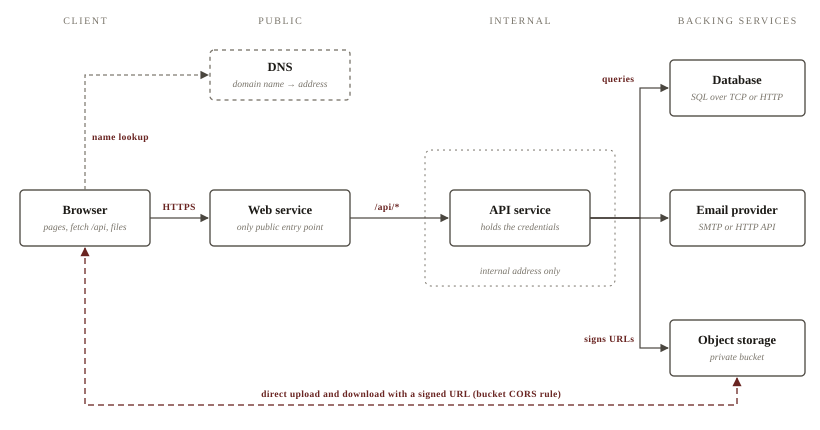

## The parts of a deployment

A web application that people use over the internet is a small distributed
system. Its code runs in at least two processes, its state lives in services
that the code does not own, and every connection between the parts crosses a
network that can fail, be slow, or be reached by someone else. A browser
speaks HTTP to a server, which answers each request with a status, headers and
a body [@mdn-http]; the rest of this book is about the machinery behind that
server.

The machinery consists of a few parts that recur in every deployment,
whatever the provider. Table 1.1 lists them with the state each one holds. Two
of them are processes that the application's authors write and run; the
others are *backing services*, attached through a locator and a credential and
replaceable without a change of code [@twelve-backing].

| Part | Role | Holds | Typical form |
|---|---|---|---|
| Browser | Runs the user interface; sends requests; uploads and downloads files | Cookies, local drafts | A desktop or mobile browser |
| Web service | Serves pages and static assets; forwards `/api` requests | Nothing durable | A container with a public address |
| API service | Business logic, authorization, signing of storage URLs, sending email | Credentials for the backing services | A container with an internal address only |
| Database | Accounts, sessions, domain records, the migration ledger | All structured data | A managed PostgreSQL instance |
| Object storage | Uploads, exports, generated documents | Bytes under object keys | A private bucket |
| Email provider | Delivers account email | Templates, the sender domain | A transactional email service |
| Identity | States which principal may do what | Users, roles, policies, keys | The provider's access-management service |
| Environment | Groups one complete copy of the above | The configuration that distinguishes it | Staging, production |

Table: The parts of a hosted web application. Chapters 2 to 8 take them in
turn.

!!! definition "Backing service"
    A service the application consumes over the network as part of its normal
    operation, such as a database, an object store or an email provider. The
    application refers to it only through configuration, a locator and a
    credential, so a local database and a managed one are interchangeable
    without a change to the code [@twelve-backing].

!!! definition "Environment"
    One complete, independent copy of a deployment: its services, database,
    bucket, identities, keys and domain. Environments run the same code and
    differ only in configuration. [Chapter 8](releases.md) treats them in
    detail.

## The request path

Figure 1.1 follows one request. The browser resolves the application's domain
name through DNS ([Chapter 2](domains.md)), opens a TLS connection to the
address it receives, and sends its request to the **web service**. The web
service answers page requests itself and forwards every request whose path
begins with `/api` to the **API service**, which has no public address. The API
authenticates the caller, applies the authorization rules, and then reads or
writes the **database**, asks for a signed **object storage** URL, or hands a
message to the **email provider**.



Files take a different path. Relaying an upload through two services would
double its transfer and occupy both for its duration, so the API instead
returns a *signed URL*, a time-limited permission to perform one operation on
one object, and the browser transfers the bytes directly to object storage
[@s3-presigned]. The API decides who may upload what; the storage service
moves the bytes. [Chapter 6](storage.md) covers signing, the bucket's CORS rule
that the direct transfer requires, and the policy that lets the API do nothing
else with the bucket.

### The same-origin pattern

The arrangement in Figure 1.1 is a choice among several. A browser treats the
scheme, host and port of a URL as its *origin*, and a script loaded from one
origin may read responses only from that same origin unless the other origin
opts in [@mdn-sop]. An application whose pages come from
`https://www.example.com` and whose API answers at `https://api.example.com`
therefore makes cross-origin requests, which the API must permit through CORS
response headers, with a preflight request before most of them [@mdn-cors].

!!! definition "Same-origin pattern"
    A layout in which the web service is the only public entry point. It
    serves the pages and forwards requests under `/api` to an API service that
    has only an internal address. The browser sees one origin for pages and
    API, so its API calls are same-origin requests.

The pattern buys three things. The browser never makes a cross-origin API call,
so no CORS policy has to be written, kept in step with the list of origins, or
debugged. Session cookies are set and read by one origin, so they can be
`HttpOnly`, `Secure` and `SameSite` without exceptions [@mdn-cookies]. And the
API, which holds every credential for the backing services, is not reachable
from the internet at all: container platforms can restrict a service to
internal traffic, so that only other services in the same network reach it
[@run-ingress].

The costs are an extra network hop on every API call and a forwarding layer
that must pass methods, headers, bodies and status codes through unchanged.
The API also has to treat the client-address and protocol headers added by the
web service as the only trustworthy ones, since it never sees the browser
directly. On some platforms an internal address does not start a service that
has scaled to zero, which forces a minimum of one API instance
([Chapter 5](services.md)).

!!! remark "Where cross-origin requests remain"
    The pattern removes cross-origin requests between the application's own
    pages and its API, not everywhere. Direct transfers to object storage are
    cross-origin by construction and need a CORS rule on the bucket
    ([Chapter 6](storage.md)), and an API offered to other sites' scripts
    needs a CORS policy of its own ([Chapter 2](domains.md)).

## Code, configuration and data

Every value a deployment depends on belongs to one of three kinds, and each
kind has its own home and its own way of changing (Table 1.2). Mixing them
causes most deployment accidents: a password committed with the code, a
feature switch kept as a database row that nobody remembers, a migration that
also edits user records.

| Kind | Examples | Lives in | Changes by |
|---|---|---|---|
| Code | Source, Dockerfile, SQL migrations, email template sources | The repository | A commit, then a release |
| Configuration | Origins, service locators, bucket name, feature switches, credentials | Each service's environment variables; a password manager for secrets | Editing the service's variables, then a new version |
| Data | Accounts, sessions, records, uploaded objects | The database and the bucket | The running application; migrations for the schema; deliberate copies |

Table: The three kinds of value and where each one lives.

*Configuration* is everything that varies between deploys of the same code,
and the usual test is whether the repository could be made public without
exposing any credential [@twelve-config]. Configuration reaches the services as
environment variables, set on each service through the platform. A release is
then one immutable build combined with one set of configuration, and a change
to either makes a new release [@twelve-build].

*Secrets* are configuration whose disclosure grants access: database
passwords, access keys, signing keys. They take the same path as other
configuration but are marked secret on the platform, so that consoles mask
them, and their record is a password-manager entry rather than a file. They
are never committed and never built into an image: build arguments and
environment variables set in a Dockerfile persist in the final image, readable
by anyone who can pull it, which is why build tools offer separate secret
mounts for values a build needs [@docker-secrets; @owasp-secrets].

!!! warning "A secret in an image or a commit is a published secret"
    Images are copied to registries, caches and every host that runs them;
    commits are copied to every clone and survive in history after the file is
    deleted. A credential that has been in either is to be treated as known to
    others and rotated ([Chapter 3](access.md)), not erased from the copies.

Environment variables are the common mechanism, not the strongest one. They are
visible to every process in the container and can leak through crash dumps or
debugging output, and some platforms can instead mount a secret as a file or
fetch it from a secret manager at startup [@owasp-secrets]. Where that option
exists it suits the most sensitive values; where it does not, a secret
environment variable on the service is the right place, and the discipline is
never to print it.

!!! recipe "A configuration inventory"
    Keep in the repository an example file that names every variable each
    service reads, with placeholders instead of values and a comment saying
    whether the value is secret. The real values live in the services'
    variables and in the password manager, never in this file.

    ```text
    # web service
    API_INTERNAL_URL=http://<api-internal-host>:<port>   # config
    PUBLIC_ORIGIN=https://<web-origin>                     # config

    # API service
    DATABASE_URL=postgresql://<user>:<password>@<host>:5432/<database>   # secret
    WEB_ORIGIN=https://<web-origin>                                     # config
    STORAGE_BUCKET=examplebucket-1250000000                             # config
    STORAGE_REGION=<region>                                             # config
    STORAGE_SECRET_ID=<storage-key-id>                                  # secret
    STORAGE_SECRET_KEY=<storage-key-secret>                             # secret
    EMAIL_SENDER=no-reply@mail.example.com                              # config
    EMAIL_SECRET_KEY=<email-key-secret>                                 # secret
    ```

    Each service checks this list at startup and exits with a message naming
    the missing or malformed variable ([Chapter 5](services.md)). The file
    doubles as the checklist for setting up a new environment.

*Data* is what the application produces while it runs. Schema changes reach the
database through migrations, which are code ([Chapter 4](databases.md)); the
rows themselves change only through the application, or through a deliberate,
verified copy when a deployment moves (Section 4.4). The database is never the
place for a setting that an operator needs to change, because there it is
invisible from the service's configuration and differs silently between
environments.

## Health endpoints

A platform that runs a service needs to know whether each instance is working,
and an operator checking a release needs the same answer. Both get it from a
*health endpoint*: a path, conventionally `/health` on the API and reachable as
`/api/health` through the web service, that answers `200 OK` with a small body
when the process can serve requests.

Container platforms distinguish three questions, each asked by its own probe
[@k8s-probes; @run-health]. A *startup* probe asks whether the instance has
finished starting; until it succeeds, the instance receives no traffic, and if
it never succeeds the instance is shut down and replaced. A *liveness* probe
asks whether a running instance is still healthy; failing it gets the instance
restarted. A *readiness* probe, where the platform offers one, asks whether the
instance should receive traffic at this moment; failing it takes the instance
out of rotation without restarting it.

The distinction decides what the endpoint may check. A liveness check that
queries the database turns a database outage into a restart loop of every API
instance, which repairs nothing, so liveness answers from the process alone. A
readiness check may include the dependencies without which the instance cannot
serve. The endpoint is unauthenticated, so it reports a status and nothing
more: no version strings, configuration values or dependency details that a
stranger could use.

!!! recipe "Checking health through the public path"
    Request the health endpoint through the web service, not the API's
    internal address, so that DNS, the certificate, the web service and the
    forwarding to the API are all exercised:

    ```bash
    curl -sS -o /dev/null -w '%{http_code}\n' https://<web-origin>/api/health
    ```

    The expected output is `200`. A `502` or `504` means that the web service
    is running but cannot reach the API; a TLS or DNS error points to
    [Chapter 2](domains.md). [Chapter 8](releases.md) extends this check into
    the verification that follows every release.

Each platform part maps the parts of Table 1.1 onto concrete products.
[Chapter 9](../cloudbase/overview.md) shows where each one lives in a CloudBase
environment, and [Chapter 13](../cloudbase/cloud-run.md) sets up the web and
API services of Figure 1.1.

!!! summary "Key points"
    - A deployment consists of a browser, a web service, an API service and
      backing services (database, object storage, email), with identities and
      environments around them.
    - In the same-origin pattern the web service is the only public entry
      point and forwards `/api` to an API that has only an internal address.
      The application's own API calls then need no CORS policy, and the
      credentials stay off the internet.
    - Files bypass both services: the API signs a URL and the browser
      transfers the bytes directly to object storage.
    - Code lives in the repository, configuration in each service's
      environment variables (secrets marked secret and recorded in a password
      manager), data in the database and the bucket. Secrets never enter
      commits or images.
    - Health endpoints answer startup and liveness probes from the process
      alone, without authentication and without details.
